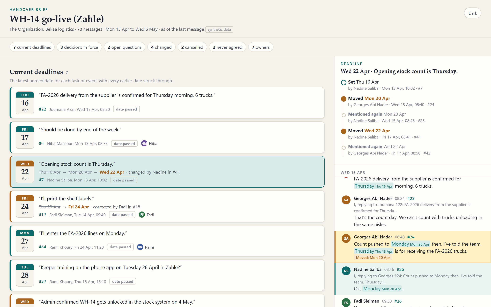
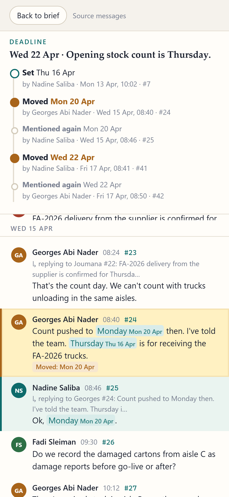
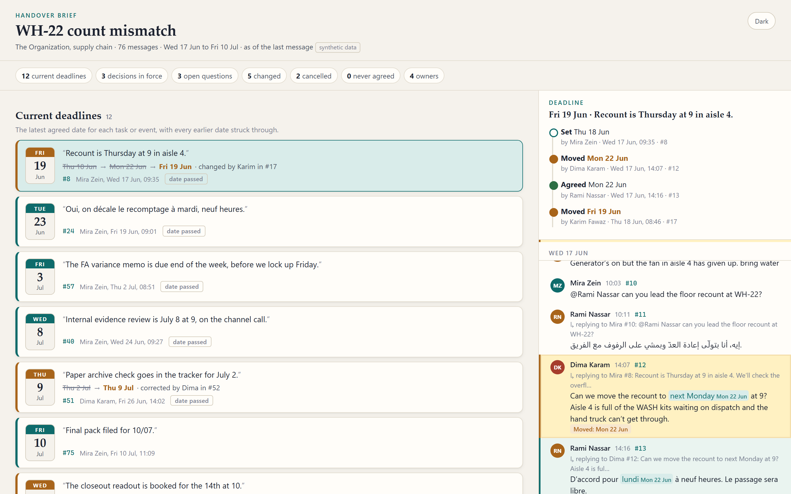

# handover-brief

Turns weeks of team chat into a handover timeline where every decision and deadline links to the message that set it, including the ones that changed.



## The need

In a humanitarian organization in Lebanon, much of the coordination happens in team chats, in Arabic, English and French: bringing a warehouse into the stock system, running an emergency operations room when shelters open in schools, following up rent contracts before they expire. When someone goes on leave or a new colleague takes over, they inherit weeks of messages and have to rebuild what is due when, what was agreed and what was called off. A summary loses the detail that matters most: the stock count that moved from Thursday to Monday, the delivery cancelled when the road closed, the follow-up date in the sheet that turned out to be wrong.

This tool lists each deadline, decision, open question, cancellation and unagreed proposal, and every item opens the exact message it came from, with its full change history beside it. There is no language model: extraction is a fixed set of rules, so every claim can be traced to a message and every behaviour can be tested. The trade-off is that the rules miss phrasings they have not seen; the held-out results below show how often.

## Try it

```
python -m venv .venv
.venv\Scripts\activate          # Windows; on macOS/Linux: source .venv/bin/activate
pip install -e .
handover serve
```

```
Serving 3 threads on http://127.0.0.1:8102/  (Ctrl+C to stop)
```

Open http://127.0.0.1:8102/, pick a thread, click any item. For a single file you can send by email or put on a shared drive:

```
handover build data/threads/warehouse-golive.json --out brief.html
```

```
78 messages -> 25 items (2 cancellation, 8 deadline, 4 decision, 7 owner, 2 proposal, 2 question)
wrote brief.html (58 KB, self-contained)
```

The page makes no external requests (no CDN, no web fonts), so it opens on a weak connection or none. It works at phone width, in light and [dark](docs/dark-changes.png). `handover items <thread.json>` prints the items as a table ([sample](docs/sample-output.txt)). `python -m handover` is the same command if your system blocks the generated launcher.



## How it works

The input is a chat thread in a small JSON format: message id, author, timestamp, text, reply-to id, edited flag ([docs/schema.md](docs/schema.md)). Field names follow the Microsoft Graph chat message format, so an export from most chat tools converts with a short script.

| Step | What it does |
|---|---|
| Resolve dates | Every date phrase is resolved against the timestamp of the message that contains it: "Friday", "next Monday", "the 14th", "end of day tomorrow", "in two weeks", "10/04", "April 10", and the French and Arabic equivalents ("lundi prochain", "le 14 avril", "dans deux semaines", "الاثنين الجاي", "بكرا"). Rules are in [dates.py](handover/dates.py). |
| Describe each message | Cue patterns in English, French and Arabic mark proposals, agreement, disagreement, requests, claims ("I'll take it", "je m'en occupe"), moves ("pushed to", "reporté à"), corrections, cancellations ("annulé", "ملغى") and announced decisions. Codes such as WH-07, S-03 or FA-2026 are kept whole, because they name the thing a message is about. |
| One pass, in order | A state machine keeps what a careful reader keeps in mind: current deadlines, open proposals, pending requests. A move changes the deadline it refers to (found by reply link, the old date, or shared words) and appends to its history. A proposal becomes a decision only when **another person** agrees; a proposed date change nobody agreed to leaves the deadline as it was. A later decision on the same topic with a reversal cue marks the earlier one reversed. |
| Unanswered questions | A question (ending in `?` or `؟`) with no reply, and no on-topic answer from someone else in the next few messages, is listed as open. Side chatter is ignored. |
| Render | Items and messages are embedded as JSON in one HTML page. Clicking an item highlights its messages and scrolls to the first change. |

Each item keeps the ids of all its source messages and a history of versions (set, moved, corrected, agreed, cancelled, reversed, handed over), with author and message for each step.

## Results

Four synthetic threads, 70 to 83 messages each, with gold labels written by the rules in [docs/labelling.md](docs/labelling.md). Each has Arabic and French messages.

| Thread | What happens | Role now |
|---|---|---|
| warehouse-golive | a warehouse joins the stock system: stock count moved twice, codes, QR labels, keeper training, the unlock day, a transfer cancelled | tuning |
| emergency-ops | shelters open in schools, urgent dispatches, a delivery cancelled when a road closed, receipts confirmed | tuning |
| rent-renewals | contracts ending in three months, next year's budget lines, a wrong follow-up date, a landlord who never answers | **unseen in the previous round, tuning data now** |
| count-investigation | a stock count that does not match the stock cards: recounts, a damage report raised then withdrawn, a transfer booked twice, who signs the adjustment | **unseen (held-out)** |

I wrote the first two. The other two, with their gold labels, were each written by a different language model from the written rules and committed before I changed any rule. I checked only their structure. Each held-out thread was measured once, at the end of its round ([docs/heldout-first-run.txt](docs/heldout-first-run.txt) holds the current one), and the rules were not changed after the measurement.

### Three generations

| Generation | Unseen thread | Tuning precision / recall | Held-out precision / recall | Stale items shown as current | Current items shown as cancelled |
|---|---|---|---|---|---|
| 1. First scenario, before the rebase | a donor report | 0.97 / 0.98 | 0.86 / 0.86 | 1 of 6 | not measured |
| 2. Rebased, rent-renewals unseen | rent-renewals | 0.94 / 0.98 | 0.67 / 0.76 | 3 of 8 | 0 of 20 |
| 3. Now, count-investigation unseen | count-investigation | 0.95 / 0.99 | **0.46 / 0.57** | **1 of 7** | **3 of 15** |

Generation 1 was scored before I found that the scorer ignored a deadline's status, so its numbers may be slightly high. Generation 2's held-out run was rescored after that fix with the extractor unchanged. The held-out samples are small (21, 29 and 23 gold items), so one item moves recall by 3 to 5 points.

What the last round shows: the rules that fixed rent-renewals (typographic quotes, two dates in a message, corrections that state the new value, cancellations that must name their event, reversals) brought the tuning threads to zero errors in both directions and cut the stale items on unseen data from 3 to 1. They did not generalise to the count investigation as a whole: overall accuracy fell, and three current items are now shown as cancelled or reversed, two of them because of a rule added in this round. The tool is still a rules engine that works well on phrasings it has seen.

Output of `handover bench` ([docs/benchmark.txt](docs/benchmark.txt)):

```
== tune (warehouse-golive, emergency-ops, rent-renewals) ==
type          gold found right  precision  recall
deadline        28    29    28       0.97    1.00
decision        11    11    11       1.00    1.00
proposal         7     8     7       0.88    1.00
owner           21    22    20       0.91    0.95
question         7     7     7       1.00    1.00
cancellation     5     5     5       1.00    1.00
change          11    11    11       1.00    1.00
all items       79    82    78       0.95    0.99
Superseded, cancelled or unagreed items shown as current: 0 (out of 22 such items in gold)
Current items shown as cancelled, reversed or handed over: 0 (out of 53 current items in gold)

== heldout (count-investigation) ==
type          gold found right  precision  recall
deadline         8    15     5       0.33    0.62
decision         5     4     2       0.50    0.40
proposal         2     0     0        n/a    0.00
owner            4     4     3       0.75    0.75
question         2     3     2       0.67    1.00
cancellation     2     2     1       0.50    0.50
change           4     5     2       0.40    0.50
all items       23    28    13       0.46    0.57
Superseded, cancelled or unagreed items shown as current: 1 (out of 7 such items in gold)
Current items shown as cancelled, reversed or handed over: 3 (out of 15 current items in gold)
```

A match needs the right type, the right source message and the right value (date and status for a deadline, status for a decision, person and status for an owner; a change needs the whole chain of dates). The two last lines of each block are the errors that hurt a handover most: something stale presented as current, and something still on presented as cancelled.

**Arabic and French.** In the held-out thread the rules read an Arabic agreement ("تمام، كل مشروع لحاله"), an Arabic acceptance of a task, a French agreement with a typographic apostrophe ("D’accord pour lundi à neuf heures"), a French correction of a date ("Petite correction ... est le 9 juillet"), a French cancellation of a visit, and an Arabic open question. They misread a French agreement that also moved the date ("Oui, on décale le recomptage à mardi", see below).

## Where it fails

From the held-out thread:



- **A refused date shown as the current one.** "Any chance of moving the recount up to Friday?" (#17) has no proposal cue the rules know, so it was applied as a move; "Friday won't work" (#18) came too late to undo it. Then "Oui, on décale le recomptage à mardi" (#24) agreed to Rami's request (#23, which used "shift", not a move verb the rules know) and became a separate deadline. The brief shows the recount on Friday 19 June; it happened on Tuesday 23 June. This breaks the one promise the tool makes, and the stale-item count does not catch it because Friday never appears in the gold chain.
- **A proposal read as a cancellation, which then cancelled two deadlines.** "Could we drop the joint sheet and sign one sheet for each project?" (#33) contains "drop the", so it was read as calling something off. It attached to message #28, which sets two deadlines (scans by tomorrow, final pack by July 10), and a rule added in this round, "call off the date and the owner of one task together", cancelled both. The joint-sheet decision it was meant to replace stays in force (the one stale item).
- **A stock movement read as a change of mind.** "Let’s append a linked reversal for the second posting only ... plus 48 back to WH-19 EA" (#47) became a decision, and "back to" is a reversal cue, so it overturned an unrelated decision ("reconcile each project and expiry on its own line", #4), which the brief now shows as reversed.
- **Expiry dates read as deadlines.** "FA-2026, expiry 30 Nov: 12 boxes + 6 pieces", "the 30 Nov row", "28 Feb 2027 rows": in a stock thread, dates are often expiry dates, and the rules turned five of them into deadlines. This is most of the drop in deadline precision.
- **A withdrawn damage report.** "Withdrawing DMG-2026-00037" (#31): "withdraw" is not a cancellation cue.
- **Ownership in other words, again.** "Leave the WH-22 adjustment sign-off with me" (#37). The rules know "leave it with me". The same phrasing failed in generation 1 ("Leave the financial workbook with me") and I still had not generalised it.
- **A decision announced as "Final call on adjustment signatures:"** (#37) and a suggestion phrased "Maybe add a photo ...?" (#49) were not recognised.

## What I would add next

- Treat a move inside a question as a proposal whatever the wording, and never let a cancellation cue inside a proposal call anything off.
- Recognise expiry dates (after "expiry", "exp", "lot", or in a row of quantities) and keep them out of deadlines.
- Then write a fifth unseen thread; this one has now been seen.
- A converter from a real chat export (HTML stripped, threads flattened) into the thread format.
- An LLM pass could propose items the rules miss, with the rules and the source links kept as the check on what it may claim.

## Licence

MIT. All threads, people, codes and figures are synthetic; the organization is not named and no real organization's material is used.
